

<picture><source media="(prefers-color-scheme: dark)" srcset="assets/hero-dark.svg"></picture>

<picture><source media="(prefers-color-scheme: dark)" srcset="assets/social-l-dark.svg"></picture><a href="https://t.me/meowwsense"><picture><source media="(prefers-color-scheme: dark)" srcset="assets/social-1-dark.svg"></picture></a><a href="https://discord.com/meowwsense"><picture><source media="(prefers-color-scheme: dark)" srcset="assets/social-2-dark.svg"></picture></a><a href="https://x.com/Obal9uy4ik"><picture><source media="(prefers-color-scheme: dark)" srcset="assets/social-3-dark.svg"></picture></a><picture><source media="(prefers-color-scheme: dark)" srcset="assets/social-r-dark.svg"></picture>

<picture><source media="(prefers-color-scheme: dark)" srcset="assets/about-dark.svg"></picture>

<picture><source media="(prefers-color-scheme: dark)" srcset="assets/stack-dark.svg"></picture>

<a href="https://github.com/meowwsense/Nexus"><picture><source media="(prefers-color-scheme: dark)" srcset="assets/project-nexus-dark.svg"></picture></a>&nbsp;<a href="https://github.com/meowwsense/assets"><picture><source media="(prefers-color-scheme: dark)" srcset="assets/project-assets-dark.svg"></picture></a>

<a href="https://github.com/meowwsense/Personalization"><picture><source media="(prefers-color-scheme: dark)" srcset="assets/project-personalization-dark.svg"></picture></a>&nbsp;<a href="https://github.com/meowwsense/modules-web"><picture><source media="(prefers-color-scheme: dark)" srcset="assets/project-modules-web-dark.svg"></picture></a>

<picture><source media="(prefers-color-scheme: dark)" srcset="assets/stats-dark.svg"></picture>

<picture><source media="(prefers-color-scheme: dark)" srcset="assets/streak-dark.svg"></picture>

<picture><source media="(prefers-color-scheme: dark)" srcset="assets/wave-dark.svg"></picture>

<a href="https://meowwsense.loc.cc"><picture><source media="(prefers-color-scheme: dark)" srcset="assets/button-1-dark.svg"></picture></a>

